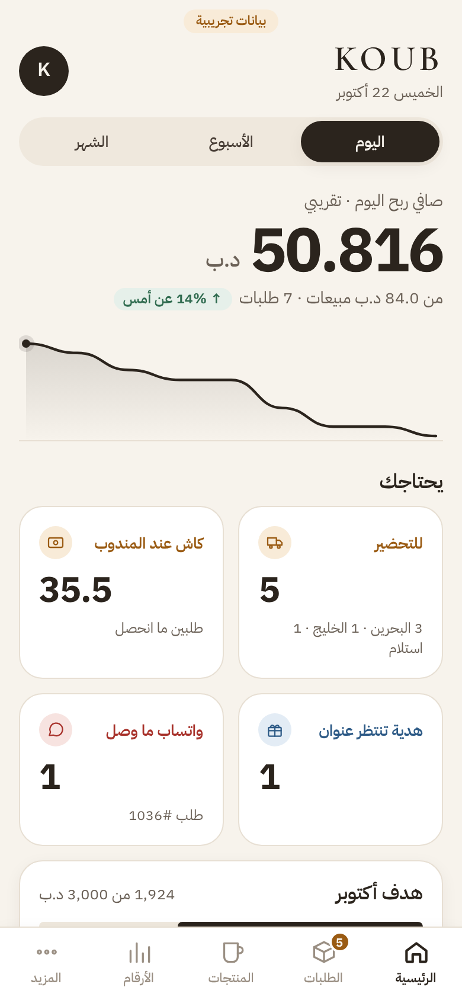
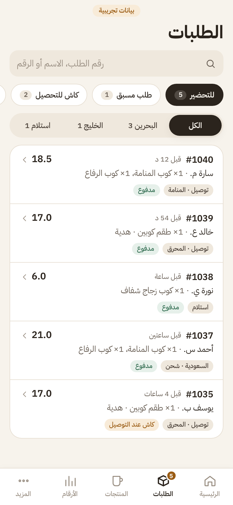
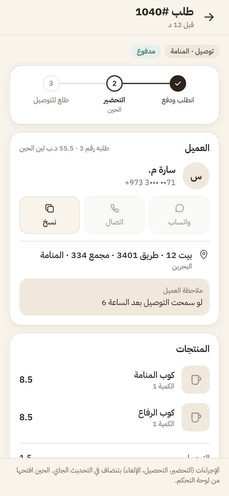
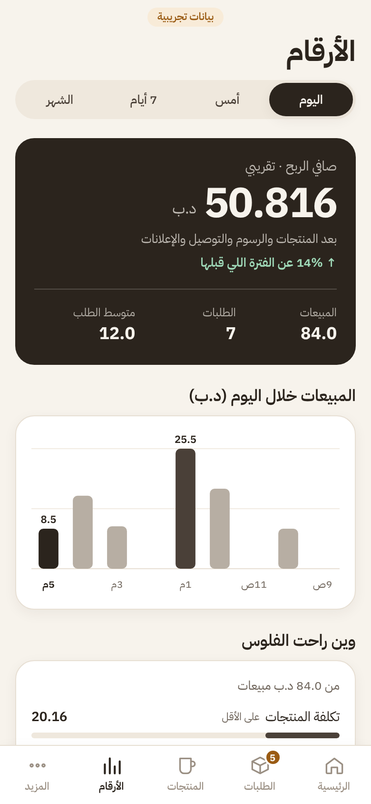
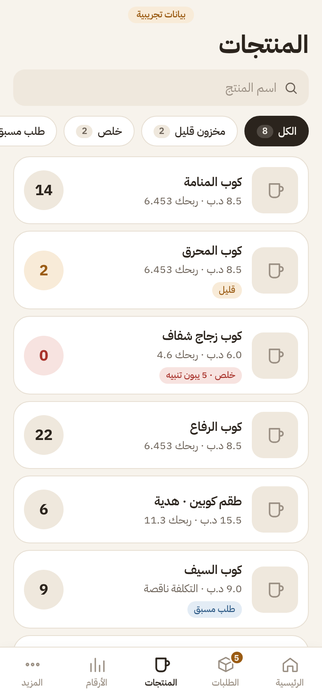
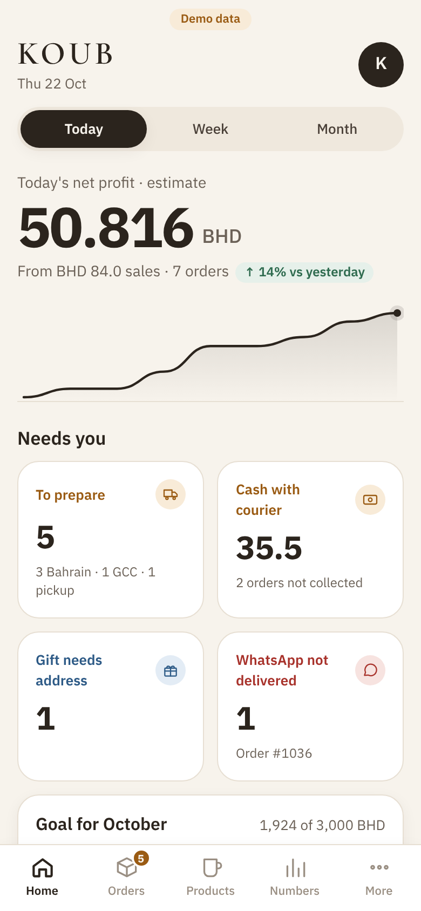
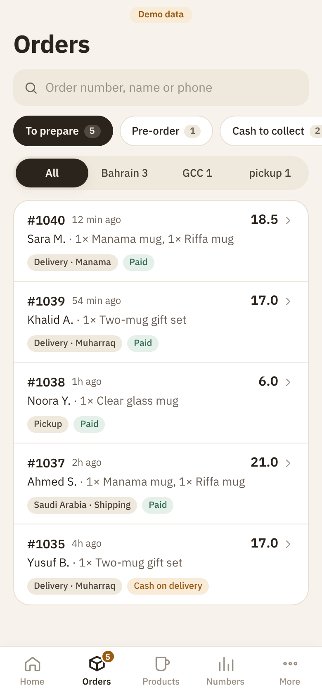
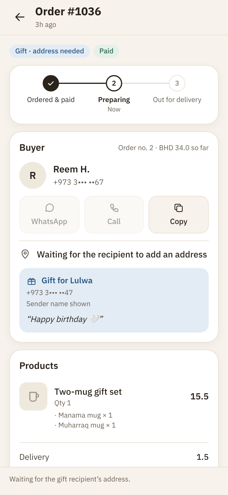
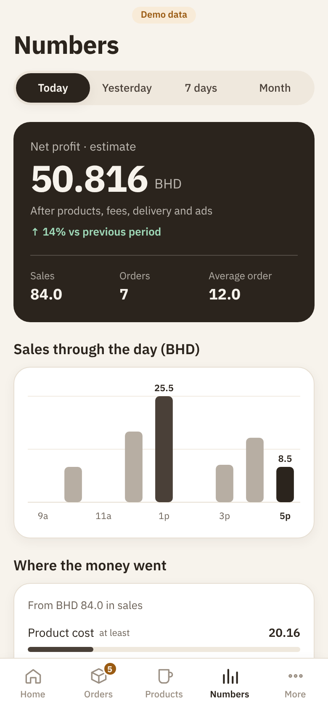
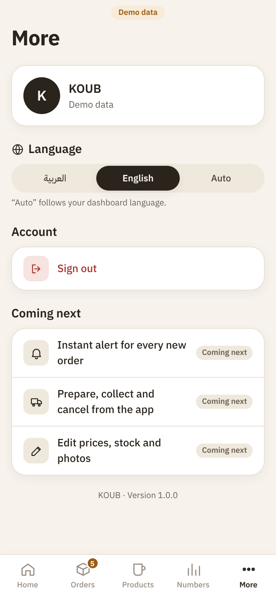

# KOUB app

The KOUB workspace on iOS and Android: orders, products and numbers from koubbh.com, in Arabic first.
Built with Expo (React Native) and Expo Router.

| Home | Orders | Order | Numbers | Products |
| --- | --- | --- | --- | --- |
|  |  |  |  |  |

|  |  |  |  |  |

Screens show invented demo data, in Arabic and English.

## Phase 1 (this version)
- Sign in with the store address, username and a WordPress **Application Password**. On a phone, credentials stay in the keychain (`expo-secure-store`). The web preview never writes them to browser storage: a real sign-in there lasts until the page reloads.
- **Home**: net profit (today / week / month) with the cumulative sales line, “needs you” tiles, monthly goal, website visitors, signals and the latest orders. Refreshes every minute.
- **Orders**: the dashboard's queues (to prepare, pre-order, cash to collect, gift address, all), destination filter, search, infinite scroll.
- **Order**: progress, customer with WhatsApp / Call / Copy, gift details, items and totals, payment, profit before ads, WhatsApp messages and the order log.
- **Numbers**: profit, KPIs, sales chart, where the money went, ads return, card and cash, best sellers, countries, order mix, abandoned carts.
- **Products**: stock buckets, search, price and unit profit, waiting stock alerts.
- **Language**: Arabic or English inside the app (More, or the button on the sign-in screen), or Auto to follow the dashboard. Store labels switch too.
- **More**: Face ID / fingerprint lock, sign out.
- Demo mode (“Try with demo data”) with invented data, no store needed.
- Pull to refresh, skeleton loading, haptics, refresh when the app returns to the foreground.

- **New-order alerts** (More → Alerts): one alert per new paid or cash order with the order number, total and delivery type, no customer details. Tapping it opens the order. Optional silent hours at night. Needs the koub-tap push update (`app-push.php`) and a KOUB build (below), not Expo Go.

Read-only: order actions and product editing come next.

## Requirements on the store
The koub-tap update with the app API (`Mbina017/koub-site`, `app-api.php`) must be installed. Until then, sign-in shows “The app API isn't on this store yet”.

## Run it
```sh
npm install
npx expo start          # scan the QR code with Expo Go (iOS / Android)
npm run typecheck
npm test
```

## KOUB build (needed for alerts)
Expo Go cannot receive remote alerts, so alerts need the app's own build, made with EAS (free Expo account):
```sh
npx eas-cli login
npx eas-cli init            # links the project and writes extra.eas.projectId to app.json
npx eas-cli build -p android --profile preview   # installable APK for staff phones
npx eas-cli build -p ios --profile preview       # needs an Apple Developer account (99 USD a year)
```
Store releases use `--profile production`, then `npx eas-cli submit`. Google Play needs a developer account (25 USD once). Bundle id: `bh.koub.app`.

## Structure
```
src/app/            screens (Expo Router)
  (tabs)/           Home, Orders, Products, Numbers, More
  order/[id].tsx    order screen
  login.tsx
src/components/     UI kit, charts, icons, order row, lock screen
src/lib/            API client, session, demo data, formatting, translations, theme
```
